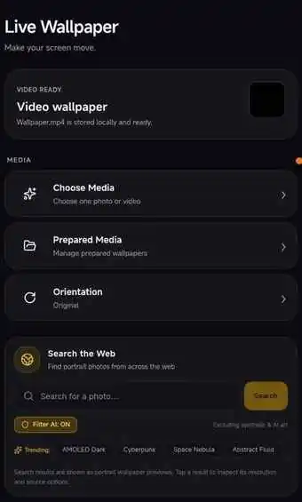
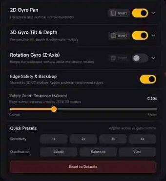
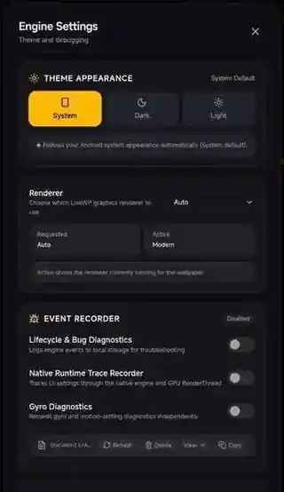

<h1 align="center">LiveStagix</h1>

  <strong>Make your screen move.</strong> 
  Photo and video live wallpapers, with motion controls and device-aware media preparation.

  <a href="https://github.com/devdas74/LiveWP-Releases/releases/latest"><strong>⬇ Download the latest APK</strong></a>
  &nbsp; · &nbsp;
  <a href="https://github.com/devdas74/LiveWP-Releases/releases">All releases</a>
  &nbsp; · &nbsp;
  <a href="https://github.com/sponsors/devdas74">Support development</a>

  

<em>Real LiveStagix app screenshot</em>

---

## Your wallpaper, your way

LiveStagix turns photos and videos into live wallpapers and gives you tools to prepare, position and personalize them.

- **Photos and videos:** preview your selection in Live Stage before applying it.
- **Custom framing:** adjust the crop, then prepare media for your device's display.
- **Prepare and reuse:** keep prepared wallpapers in your library instead of repeating the same preparation.
- **Find a photo:** search the web for portrait wallpaper images directly from Controls.

## Motion that responds to you

Photo wallpapers can use gyroscope-based effects, including 2D pan, 3D tilt and depth, and Z-axis rotation. Edge safety helps protect the edges while the image moves, and quick presets make it easier to tune sensitivity and stabilization.

  
<strong>View the motion controls screenshot</strong>

  

    
  

## Video enhancements and rendering

On supported devices, video wallpapers can use **Frame Interpolation** for smoother motion and **Smart Upscale** for enhancement. Choose **Auto**, **Modern** or **Compatibility** rendering; the renderer that is actually active may differ from the requested setting when device support requires it.

Features and performance vary with Android version, graphics hardware, supported codecs and runtime conditions.

  
<strong>View Advanced Settings</strong>

  

    
  

## Updating a wallpaper that's already active

When LiveStagix is already the active wallpaper, applying new prepared media first attempts to update its content in place. When that succeeds, the wallpaper changes without reopening Android's wallpaper preview.

If an in-place update fails, LiveStagix automatically retries up to **three times**, with a short pause between attempts. If all three fail, it falls back to the established wallpaper replacement flow and opens Android's wallpaper preview and confirmation.

## Get started

1. [Download the latest APK](https://github.com/devdas74/LiveWP-Releases/releases/latest) and install it.
2. Open LiveStagix and choose a photo or video. You can also search for a photo from Controls.
3. Switch to **Live Stage** and tap **Prepare**.
4. When preparation completes, tap **Set as Wallpaper**.
5. For first-time setup or replacement, complete Android's wallpaper preview and confirmation.

## Frequently asked questions

**Why are some controls unavailable?**  
Motion controls are intended for photo wallpapers; video enhancements are intended for video wallpapers. Other options depend on your device's capabilities.

**Will every phone support the same enhancements?**  
No. Android version, graphics hardware, codecs and runtime load affect which paths can be used and how well they perform.

**Does an in-place wallpaper update always work?**  
No. LiveStagix retries up to three times, then uses its existing replacement flow if needed.

**Where can I check for app updates?**  
Open **Advanced Settings** to check manually. LiveStagix also checks when opened, at most once every 24 hours; it does not need a separate daily background service.

## About

This repository distributes official LiveStagix APK releases. The source code and build system are maintained separately.

LiveStagix is proprietary software. No open-source license is granted by this repository.
